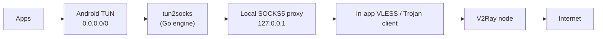

<div align="center">


# MEH VPN

**کلاینت مینیمال V2Ray برای اندروید؛ یک دکمه، بدون تنظیمات.**

[](https://github.com/MEH-VPN/MEH-VPN/releases/latest)
[](#نصب)
[](#ساخت-از-سورس)

[دانلود آخرین نسخه](https://github.com/MEH-VPN/MEH-VPN/releases/latest) · [English summary](#english-summary)

</div>

<div dir="rtl" align="right">

## MEH چیست؟

MEH یک اپ اندرویدی برای اتصال به V2Ray است که خودش کانفیگ‌ها را از لیست عمومی [SoliSpirit/v2ray-configs](https://github.com/SoliSpirit/v2ray-configs) می‌گیرد، سرورها را تست می‌کند و به بهترین گزینه‌ها وصل می‌شود. کاربر فقط یک دکمه را می‌زند.

هسته‌ی اتصال از نظر پروتکل (VLESS/Trojan) داخل خود اپ نوشته شده و به باینری Xray یا sing-box وابسته نیست. تنها بخش بومی پروژه موتور `tun2socks` (کتابخانه‌ی Go) است.

## ویژگی‌ها

- **اتصال با یک دکمه.** دریافت لیست سرورها، تست و اتصال به‌صورت خودکار انجام می‌شود.
- **تست دو مرحله‌ای قبل از اتصال.** ابتدا یک پروب سریع HTTP، سپس تست واقعی HTTPS روی پورت ۴۴۳ داخل تونل (Google، Instagram، X/Twitter و دیتاسنتر تلگرام) انجام می‌شود. فقط سرورهای سالم انتخاب می‌شوند.
- **استخر سرورهای جایگزین.** تا ۶ سرور متنوع (از نظر زیرشبکه و SNI) انتخاب می‌شود. اگر باز کردن اتصال به سرور فعال شکست بخورد، اپ سراغ سرور بعدی می‌رود.
- **چند آینه برای دریافت لیست.** لیست از jsDelivr (CDN، Fastly، GCore) و GitHub Raw گرفته می‌شود تا با مسدود شدن یکی، بقیه کار کنند.
- **VPN کامل سطح دستگاه** از طریق `VpnService` اندروید (همه‌ی اپ‌ها، به‌جز خود MEH).
- **DNS داخل تونل.** پرسش‌های DNS به پروکسی محلی می‌رسند و دامنه‌ها در سمت سرور resolve می‌شوند (جزئیات در [نحوه کار](#نحوه-کار)).
- **رابط فارسی و راست‌به‌چپ** با فونت Vazirmatn.

## نصب

1. آخرین فایل APK را از صفحه‌ی [Releases](https://github.com/MEH-VPN/MEH-VPN/releases/latest) دانلود کنید (`MEH-VPN-vX.Y.Z.apk`).
2. نصب از منبع ناشناس را برای مرورگر یا فایل‌منیجر خود مجاز کنید و APK را نصب کنید.
3. اپ را باز کنید و دکمه‌ی وسط صفحه را بزنید. بار اول اندروید مجوز VPN را می‌پرسد.

حداقل نسخه‌ی اندروید ۵.۰ (API 21) است.

APKهای Releases با کلید debug امضا می‌شوند و این کلید در هر بیلد CI از نو ساخته می‌شود. اگر نصب روی نسخه‌ی قبلی با خطای تداخل پکیج روبه‌رو شد، نسخه‌ی قبلی را حذف و دوباره نصب کنید.

## نحوه استفاده

دکمه‌ی وسط صفحه را بزنید. خط وضعیت زیر دکمه مراحل را نشان می‌دهد: `دریافت لیست سرور ها` ← `تست سرور ها` ← `در حال اتصال` ← `متصل`. برای قطع اتصال دوباره دکمه یا گزینه‌ی «قطع اتصال» در اعلان را بزنید. اگر هیچ سروری پیدا نشود یا راه‌اندازی تونل شکست بخورد، دکمه حالت خطا می‌گیرد و می‌توانید دوباره امتحان کنید.

</div>

## نحوه کار



<div dir="rtl" align="right">

| بخش | کار |
|---|---|
| `SoliSpiritRepository` | دریافت لیست از آینه‌ها، پارس کانفیگ‌ها، تست دو مرحله‌ای و انتخاب متنوع‌ترین سرورهای سریع |
| `MehVpnService` | ساخت رابط TUN (فقط IPv4، MTU ‏1400)، اجرای `tun2socks`، نگه‌داشتن سرویس در پیش‌زمینه |
| `LocalV2RayProxyServer` | SOCKS5 (TCP و UDP ASSOCIATE) و HTTP CONNECT محلی، DNS، استخر سرور و failover |
| `V2RayOutboundClient` | اتصال خروجی VLESS/Trojan روی TCP، WebSocket یا HTTPUpgrade، با TLS یا بدون آن |
| `GfwKnockerXrayCore` | ابزارهای TLS/SNI و fragment کردن `ClientHello` |
| `V2RayConfigParser` | پارس لینک‌های `vless://` `trojan://` `vmess://` `ss://` و اشتراک‌های base64 |

**نکات فنی**

- سوکت‌های خروجی با `VpnService.protect()` از تونل مستثنی می‌شوند تا حلقه ایجاد نشود.
- پاسخ پرسش‌های DNS نوع A فوراً با یک IP ساختگی ثابت از بازه‌ی `198.54.0.0/16` داده می‌شود و پروکسی هنگام اتصال، دامنه را از روی IP ساختگی یا SNI یا هدر `Host` برمی‌گرداند. VLESS و Trojan دامنه را به سرور می‌دهند و سرور آن را resolve می‌کند. رکوردهای `AAAA` و `HTTPS/SVCB` عمداً خالی جواب داده می‌شوند.
- UDP غیر از DNS (مثلاً QUIC روی ۴۴۳) رها می‌شود و اپ‌ها به TCP برمی‌گردند.
- `ClientHello` چندقطعه‌ای TLS قبل از استخراج SNI دوباره سرهم می‌شود.
- پروفایل‌های fragment (مثل `patterniha_frag_a/b`) برای کانفیگ‌هایی که این پارامترها را دارند در کد پشتیبانی می‌شوند.

## انتخاب سرور

1. لیست از آینه‌ها گرفته می‌شود و فقط کانفیگ‌های سازگار با موتور (جدول پایین) نگه داشته می‌شوند. دریافت با حدود ۲۵۰ کانفیگ متوقف می‌شود.
2. کانفیگ‌ها به‌صورت تصادفی مرتب و در دسته‌های ۸۰تایی (حداکثر ۳ دسته) با ۳۲ تست هم‌زمان بررسی می‌شوند.
3. **مرحله‌ی اول:** یک درخواست `generate_204` از داخل سرور. سرورهای ناموفق حذف می‌شوند.
4. **مرحله‌ی دوم:** ۱۲ سرور سریع‌تر با چند تست هم‌زمان داخل تونل بررسی می‌شوند: HTTPS به Google، X/Twitter، Instagram و اتصال به دیتاسنتر تلگرام. سرورها بر اساس تعداد تست‌های موفق در سه رده قرار می‌گیرند و رده‌ی بهتر ترجیح داده می‌شود.
5. اگر دست‌کم ۴ سرور رده‌ی اول با تأخیر کمتر از ۵۵۰ میلی‌ثانیه پیدا شود، جست‌وجو همان‌جا تمام می‌شود.
6. تا ۶ سرور از زیرشبکه‌ها و دامنه‌های SNI متفاوت انتخاب می‌شوند. اولی فعال است و بقیه جایگزین‌اند.

## پروتکل‌ها و محدودیت‌ها

| مورد | وضعیت |
|---|---|
| VLESS (و گونه‌های MVLESS/JVLESS)، Trojan | پشتیبانی می‌شود |
| Transport: `tcp`، `ws`، `httpupgrade` | پشتیبانی می‌شود |
| Security: `tls` یا `none` | پشتیبانی می‌شود |
| VMess، Shadowsocks | پارس می‌شوند ولی برای اتصال استفاده نمی‌شوند |
| Reality (`pbk`)، gRPC، xhttp، آدرس سرور IPv6 | پشتیبانی نمی‌شود، چنین کانفیگ‌هایی کنار گذاشته می‌شوند |
| VLESS با `flow` (مثل `xtls-rprx-vision`) | پشتیبانی نمی‌شود، کلاینت همیشه addons خالی می‌فرستد |
| IPv6 روی TUN | غیرفعال است |
| UDP غیر از DNS | پشتیبانی نمی‌شود |
| Split tunneling | وجود ندارد؛ همه‌ی اپ‌ها به‌جز MEH از تونل رد می‌شوند |
| سروری که اتصال را قبول می‌کند ولی داده برنمی‌گرداند | خودکار تشخیص داده نمی‌شود. failover فقط وقتی انجام می‌شود که باز کردن اتصال به سرور شکست بخورد. در این حالت قطع و وصل کنید |

## مجوزهای اندروید

| مجوز | دلیل |
|---|---|
| `INTERNET`، `ACCESS_NETWORK_STATE` | دریافت لیست سرورها و اتصال به سرورها |
| `FOREGROUND_SERVICE`، `FOREGROUND_SERVICE_SPECIAL_USE` | نگه‌داشتن سرویس VPN در پیش‌زمینه با اعلان وضعیت |
| `WAKE_LOCK` | در Manifest اعلام شده ولی کد فعلی از WakeLock استفاده نمی‌کند |
| `BIND_VPN_SERVICE` (روی سرویس) | ساخت رابط VPN با تأیید کاربر |

## حریم خصوصی و امنیت

لطفاً قبل از استفاده این موارد را بخوانید.

- **سرورها عمومی و ناشناس‌اند.** کانفیگ‌ها از یک لیست عمومی می‌آیند. صاحب سرور مقصد و حجم ترافیک شما را می‌بیند. ترافیک HTTPS داخل تونل رمزنگاری‌شده می‌ماند ولی ترافیک HTTP ساده برای سرور قابل مشاهده است. برای کارهای حساس (بانکی، ورود به حساب‌ها) از این اپ استفاده نکنید.
- **اعتبارسنجی گواهی سرور خاموش است.** اتصال TLS اپ به سرورهای V2Ray هر گواهی را می‌پذیرد (`permissiveSslContext` در `V2RayOutboundClient.kt`)، چون بسیاری از کانفیگ‌های عمومی گواهی معتبر یا SNI درست ندارند. این یعنی مهاجمِ وسط مسیر می‌تواند خودش را جای سرور جا بزند. رمزنگاری انتها‌به‌انتهای HTTPS خودِ سایت‌ها به این مورد وابسته نیست.
- **تلمتری فعال است و در اپ راهی برای خاموش کردنش نیست.** اپ با Firebase Analytics داده می‌فرستد (جزئیات در `MehTelemetry.kt`):
  - یک شناسه‌ی تصادفی و ناشناس برای هر نصب (`meh_…`) به‌عنوان user id، و ویژگی‌های کاربر: نسخه‌ی اپ، نسخه‌ی SDK اندروید، سازنده و مدل گوشی و وضعیت VPN.
  - رویدادها: باز شدن اپ و صفحه، تلاش برای اتصال، تعداد کانفیگ‌های دریافت‌شده، اتصال موفق و قطع اتصال، و در حالت متصل هر ۶۰ ثانیه یک ضربان فعالیت.
  - در رویداد اتصال و ضربان: پروتکل، نام سرور و تأخیر. ضربان مدت اتصال را هم دارد.
  - گزارش خطا و کرش: مرحله، نوع خطا، متن کوتاه (حداکثر ۱۰۰ نویسه) و محل خطا در کد. متن خطا ممکن است نام سرور یا میزبان را داشته باشد. گزارش‌هایی که در حالت قطع اتصال رخ می‌دهند روی گوشی نگه داشته می‌شوند (حداکثر ۲۵ مورد) و بعداً ارسال می‌شوند.
  - کد اپ محتوای ترافیک یا لیست سایت‌های بازدیدشده را نمی‌فرستد. خود Firebase طبق رفتار معمول داده‌های استانداردی مثل موقعیت تقریبی از روی IP را هم جمع می‌کند.

## عیب‌یابی

- **وصل می‌شود ولی سایتی باز نمی‌شود.** چند بار قطع و وصل کنید. هر اتصال از لیست عمومی سرورهای تازه انتخاب می‌کند و کیفیتشان متفاوت است. در تنظیمات اندروید گزینه‌ی Private DNS را روی Off یا Automatic بگذارید.
- **اپ‌هایی که QUIC/HTTP3 دارند اول کند باز می‌شوند.** UDP عمداً رها می‌شود و اپ بعد از چند ثانیه به TCP برمی‌گردد.
- **لیست سرور دریافت نمی‌شود.** همه‌ی آینه‌ها (jsDelivr و GitHub) از شبکه‌ی شما مسدودند. شبکه‌ی دیگری را امتحان کنید.
- **لاگ خطاها:** `adb logcat -s MehTelemetry`
- برای گزارش باگ، نسخه‌ی اپ، مدل گوشی، نسخه‌ی اندروید و اینکه کدام اپ‌ها کار می‌کنند و کدام نه را در Issue بنویسید.

## ساخت از سورس

نیازمندی‌ها: JDK 17، Android SDK (`compileSdk 36`) و Gradle 9.3.1. مخزن فایل `gradlew` ندارد و CI مستقیم از Gradle 9.3.1 استفاده می‌کند.

</div>

```bash
git clone https://github.com/MEH-VPN/MEH-VPN.git
cd MEH-VPN

# debug.keystore در .gitignore است؛ همان‌طور که CI می‌سازد
keytool -genkey -v -keystore debug.keystore -storepass android \
  -alias androiddebugkey -keypass android -keyalg RSA -keysize 2048 \
  -validity 10000 -dname "CN=Android Debug,O=Android,C=US"

gradle assembleDebug
# خروجی: app/build/outputs/apk/debug/app-debug.apk

gradle testDebugUnitTest   # تست‌های واحد
```

<div dir="rtl" align="right">

بیلد release به متغیرهای محیطی `KEYSTORE_PATH`، `STORE_PASSWORD` و `KEY_PASSWORD` و یک keystore با alias `upload` نیاز دارد.

بیلد با پلاگین Google Services وابسته به Firebase است. در نبود `google-services.json`، فقط هشدار می‌دهد و بیلد ادامه پیدا می‌کند.

## انتشار نسخه

ورک‌فلوی [Build Android APK](.github/workflows/build-apk.yml) فقط با push یک تگ مثل `v1.4.0` (یا اجرای دستی) اجرا می‌شود. push یا pull request معمولی چیزی نمی‌سازد و بیلد را بررسی نمی‌کند. با تگ، APK ساخته و با نام `MEH-VPN-<tag>.apk` همراه یادداشت‌های خودکار در Releases منتشر می‌شود.

## ساختار پروژه

</div>

```text
app/src/main/java/com/example/
├── MainActivity.kt               رابط Compose
├── ui/MehViewModel.kt            جریان اتصال و وضعیت UI
├── data/SoliSpiritRepository.kt  دریافت، تست و انتخاب سرورها
├── model/V2RayConfig.kt          مدل و پارسر کانفیگ
├── vpn/
│   ├── MehVpnService.kt          VpnService و tun2socks
│   ├── LocalV2RayProxyServer.kt  SOCKS5/HTTP محلی، DNS، failover
│   ├── V2RayOutboundClient.kt    VLESS/Trojan، WebSocket، TLS
│   └── GfwKnockerXrayCore.kt     TLS/SNI و fragment
└── telemetry/MehTelemetry.kt     Firebase Analytics
```

<div dir="rtl" align="right">

## مشارکت

Issue و Pull Request خوش‌آمد است. چون CI فقط روی تگ بیلد می‌گیرد، لطفاً قبل از ارسال PR یک بار `gradle assembleDebug` را محلی اجرا کنید.

## سپاس

- [SoliSpirit/v2ray-configs](https://github.com/SoliSpirit/v2ray-configs) برای لیست کانفیگ‌ها
- [xjasonlyu/tun2socks](https://github.com/xjasonlyu/tun2socks): کتابخانه‌ی `com.ooimi.library:tun2socks` که اپ از آن استفاده می‌کند، همان API پکیج `engine` این پروژه را دارد
- [Vazirmatn](https://github.com/rastikerdar/vazirmatn) برای فونت
- پروژه‌های GFW-knocker، CluvexStudio/Aether، WhiteDNS و patterniha که ایده‌ی fragment کردن `ClientHello` از آن‌ها گرفته شده است

## مجوز

هنوز فایل `LICENSE` به مخزن اضافه نشده است. تا آن زمان حقوق استفاده و بازتوزیع مشخص نیست.

</div>

---

## English summary

MEH is a minimal one-tap V2Ray client for Android (5.0+). It fetches public configs from [SoliSpirit/v2ray-configs](https://github.com/SoliSpirit/v2ray-configs) through several CDN mirrors, benchmarks nodes with a two-stage test (HTTP probe, then real HTTPS to Google, Instagram, X and Telegram through the node), and connects through a full-device `VpnService` TUN.

- **Data path:** TUN → `tun2socks` (Go engine) → local SOCKS5/HTTP proxy → in-app VLESS/Trojan client (TCP, WebSocket or HTTPUpgrade, with or without TLS) → node.
- **DNS:** `A` queries get a stable fake IPv4 (`198.54.0.0/16`); the proxy maps it back to the hostname using the fake-IP mapping, TLS SNI or HTTP `Host`, and the node resolves it. `AAAA` and `HTTPS/SVCB` answers are empty, and non-DNS UDP is dropped so QUIC falls back to TCP.
- **Failover:** up to six diverse nodes are kept. Opening a stream on the active node falls through to the next one on failure. A node that accepts streams but returns no data is not detected automatically; reconnect to pick new nodes.
- **Not supported:** Reality, gRPC, xhttp, VLESS `flow`, IPv6; VMess and Shadowsocks links are parsed but not used.
- **Build:** JDK 17, Android SDK 36, Gradle 9.3.1 (`gradle assembleDebug`; create `debug.keystore` first, see the Persian section). CI builds and publishes an APK only when a `v*` tag is pushed.
- **Privacy and security:** nodes are anonymous public servers, TLS certificate validation to nodes is disabled, and Firebase Analytics telemetry is on with no in-app opt-out (anonymous install ID, device model, connect/heartbeat events with server name and latency, error reports).
- **License:** none specified yet.
